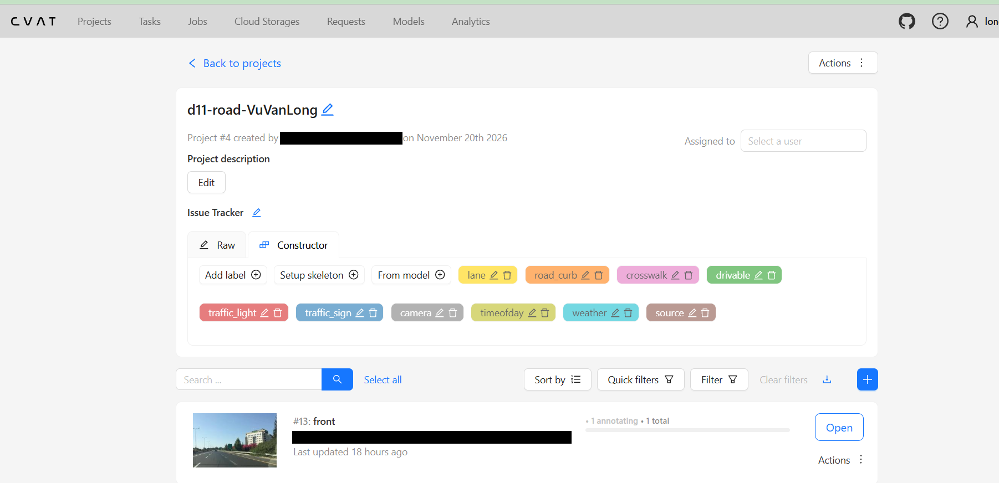
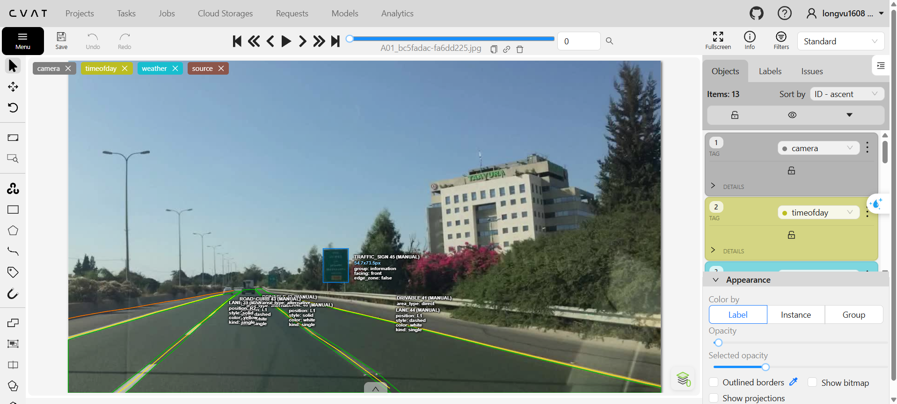
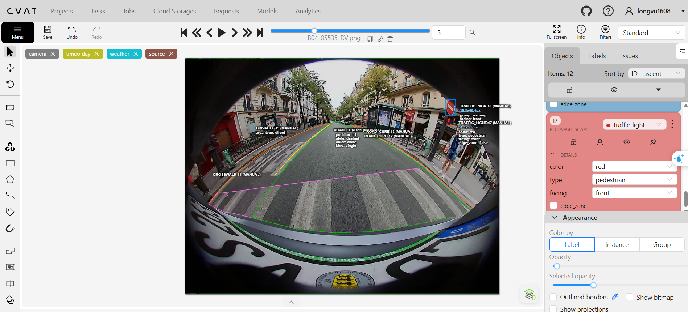
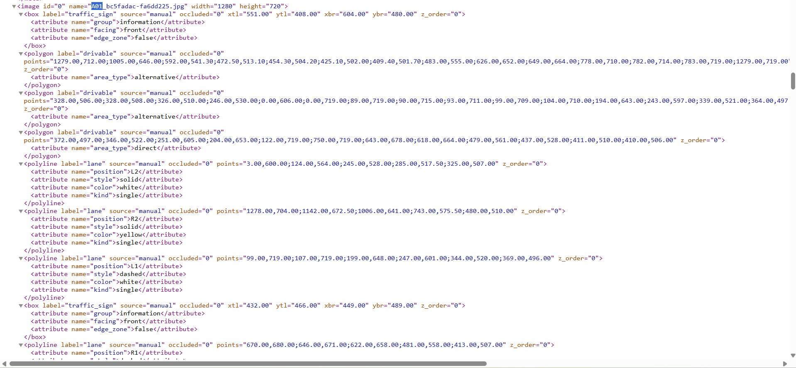

# Báo cáo cá nhân — Ngày 11
Họ tên: Vũ Văn Long (vuvanlong)               Mã học viên: 2A202603312  
Phiên bản CVAT (Help → About): CVAT 2.74.1 (Server 2.74.1, UI 2.74.1)  
Guideline: Road v1.0    Lần nộp (`revision` trong manifest): 1  
Thời điểm export (ngày giờ trên CVAT): 21/11/2026, 09:21 giờ Việt Nam (02:21 UTC, theo thẻ `<dumped>` trong `annotations.xml`)    Số lần nộp lại sau Rework: 0  

## 1. Kiểm project
| Mục | Đúng như guideline Road v1.0? | Ghi chú |
| --- | --- | --- |
| 6 label, đúng kiểu | Đúng | lane, road_curb là polyline; crosswalk, drivable là polygon; traffic_light, traffic_sign là rectangle. Đã đối chiếu với `python -m road_lab.taxonomy` và phần `<labels>` trong `annotations.xml`. |
| Thuộc tính và giá trị | Đúng | lane: position (L1, R1, L2, R2, other), style (solid, dashed), color (white, yellow, other), kind (single, double). drivable: area_type (direct, alternative). traffic_light: color, type, facing, edge_zone. traffic_sign: group, facing, edge_zone. Khớp với bảng ở guideline mục 1. |
| 4 tag ảnh | Đúng | Cả 20 ảnh đủ 4 tag (manifest: `images_all_tags` = 12 và 8). |
Cách kết thúc polyline trên bản CVAT này: bấm phím **N**.  
Cách đặt tag ảnh trên bản CVAT này: mỗi tag là một label kiểu Tag, thuộc tính `value` chọn giá trị (ví dụ `camera` = `front`).  

## 2. Số lượng đã gán
Số liệu lấy từ manifest và `annotations.xml` của hai file zip.

| Task | Ảnh | lane | road_curb | crosswalk | drivable | traffic_light | traffic_sign |
| --- | ---: | ---: | ---: | ---: | ---: | ---: | ---: |
| front | 12 | 28 | 1 | 7 | 25 | 27 | 32 |
| front-extra (đã làm 0 / 4) | 0 | 0 | 0 | 0 | 0 | 0 | 0 |
| fisheye | 8 | 12 | 4 | 15 | 11 | 11 | 16 |
| fisheye-extra (đã làm 0 / 4) | 0 | 0 | 0 | 0 | 0 | 0 | 0 |

## 3. Bảng ca khó
| Ảnh | Nhãn | Phân vân giữa | Đã chọn | Lý do |
| --- | --- | --- | --- | --- |
| A06 | lane | vạch vàng đôi một liền một đứt (QCVN 1.4): `solid` hay `dashed` | dashed (kèm color=yellow, kind=double) | v1.0 không có style riêng cho vạch này; chọn nửa sát làn xe mình |
| A06 | traffic_sign | biển bị che 2/5, hình thoi | vẽ hộp ôm cả biển | hình thoi đối xứng nên suy ra được phần bị che; group = warning |
| A08 | crosswalk | che 2/5 tới lề đường: vẽ phần thấy hay nội suy | nội suy tới lề | lề là mốc cố định, các vạch song song nên suy ra được |
| A08 | traffic_sign | biển trắng chữ nhật nhiều dòng chữ mờ phía trên biển xanh | prohibitory | không đọc được chữ, dạng biển quy định |
| A02 | drivable | làn khẩn cấp bên phải vạch trắng liền | không đưa vào `direct`, không vẽ `alternative` | không phải làn đang đi; guideline loại lề và dải đỗ |
| A04 | lane | vạch bị mất đoạn rồi xuất hiện lại (giao lộ hoặc bạc màu) | tách hai polyline nếu mất dài; nối và bật occluded nếu ngắn | guideline chỉ nêu trường hợp bị che ngắn |
| A05 | lane | không thấy vạch kẻ nào | không vẽ L1/R1 | coach xác nhận không thấy vạch, lint báo QC1-02 |
| A07 | lane | bên trái là dải bê tông chắn, có vạch L1 không | không vẽ L1 | không có vạch sơn; coach xác nhận |
| A09 | lane | bên phải chỉ có vệt trắng mờ không liên tục, có phải R1 không | không vẽ R1 | không thấy vạch liên tục; coach xác nhận |

## 4. Phiếu QC 1 nhận được
Bạn kiểm lô của tôi: chưa nhận được phiếu tại thời điểm nộp  Quyết định nhận được: chưa có  
| Mã lỗi | Số lỗi | Đồng ý? | Đã sửa? |
| --- | ---: | --- | --- |
| Chưa có phiếu | 0 | không áp dụng | không áp dụng |

Lần nộp đầu (revision 1) chưa có phiếu nhận được. Lint của chính mình ban đầu báo 4 ảnh thiếu L1/R1: A05 (cả hai), A07 (L1), A08 (L1), A09 (R1).
- A08: đã thêm vạch L1 (đứt, trắng, rất mờ nhưng nhìn thấy khi phóng to) trước khi nộp.
- A05 (đường hai chiều hẹp, xe đỗ hai bên, không có vạch), A07 (bên trái là dải bê tông chắn) và A09 (bên phải chỉ có vệt trắng mờ không liên tục): không thấy vạch thật nên không vẽ. Coach đã xem và xác nhận cả ba ảnh không thấy vạch, nên lỗi QC1-02 ở A05 (L1, R1), A07 (L1) và A09 (R1) được miễn theo ngoại lệ trong đặc tả bàn giao. Lint vẫn đếm 4 cảnh báo này trong manifest vì lint không có GT.

## 5. Kiểm file export
| File | Mở lại được? | Số shape ảnh 1 (job / file) | Số shape ảnh 2 (job / file) | Tag camera có trong XML? |
| --- | --- | --- | --- | --- |
| vuvanlong-front.zip | Có (lint mở được, 12 ảnh) | A01: 9 / 9 | A02: 5 / 5 | Có (`front`) |
| vuvanlong-fisheye.zip | Có (lint mở được, 8 ảnh) | B01: 2 / 2 | B02: 9 / 9 | Có (`fisheye_front`) |

Số trong job lấy từ ô Items của panel Objects trừ 4 tag ảnh (ví dụ A01 hiện Items: 13 = 9 shape + 4 tag).

Manifest: `contains_images` = false cho cả hai file, `revision` = 1. Lint lúc tạo manifest: 4 nặng (QC1-02 ở A05, A07, A09), 0 chính, 1 nhẹ.

## 6. Ảnh chụp màn hình
1. Tab Labels của project `d11-road-VuVanLong`: đủ 6 label vẽ (lane, road_curb, crosswalk, drivable, traffic_light, traffic_sign) và 4 label Tag (camera, timeofday, weather, source). Email đã được che.  
   
2. Ảnh camera trước A01 đã gán (làn, vùng lái, biển, đủ 4 tag).  
   
3. Ảnh fisheye B04 đã gán: polyline đi theo cung cong, kèm vùng lái và crosswalk.  
   
4. Đoạn `annotations.xml` của A01 có `<polyline label="lane">` với thuộc tính position, style, color, kind (trong file có 28 polyline lane ở front, 12 ở fisheye).  
   

## 7. Tự đánh giá
Lỗi bạn mắc nhiều nhất hôm nay (theo mã QC1-xx), và cách tránh ở Ngày 20: QC1-02 (thiếu L1/R1). Lint báo 4 ảnh: A05, A07, A08, A09. Sau khi xem lại, A08 có vạch L1 đứt rất mờ mà tôi bỏ sót nên đã thêm; A05, A07, A09 thật sự không thấy vạch và coach đã xác nhận. Cách tránh ở Ngày 20: trước khi kết luận "không thấy vạch" phải phóng to và tăng tương phản để tìm vạch mờ, rồi mới hỏi coach. Ngoài ra tôi mắc lỗi QC1-06 ở A06: vạch vàng đôi (một nửa liền, một nửa đứt) bị gán nhầm thành white/single, tôi đã sửa thành yellow/double. Từ giờ gán xong mỗi vạch tôi sẽ kiểm lại cả bốn thuộc tính, nhất là màu và kind.  
Nhãn của tôi đi vào model huấn luyện nhận diện làn (kiểu row-anchor hoặc phân đoạn làn) và nhận diện vùng lái. Lỗi đã sửa để phân tích: ở A06, vạch vàng đôi bị gán thành white/single. Nhãn này làm model học rằng vạch vàng đôi (vạch tim đường, xe không được vượt) giống vạch trắng đơn (vạch có thể chia làn cùng chiều). Khi chạy thật, model có thể coi đường tim hai chiều là làn cùng chiều, dẫn tới xe LKA hoặc lập kế hoạch đường đi tính cả làn ngược chiều là làn được phép sang. Với lỗi QC1-02, nếu A08 vẫn thiếu L1 thì ở hàng ảnh đó model học là "không có làn", làm xe khó giữ làn.  

## 8. (Tùy chọn, buffer) Từ polyline đến đích row-anchor
Không làm.
